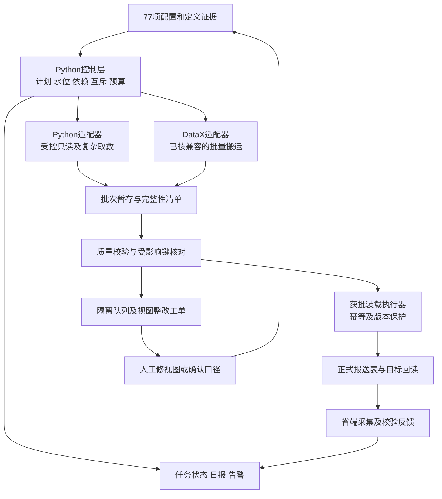

> 类别：189每日T+1专项实施细化；版本v1.0，2026-10-19。承接原方案T0—T5，唯一状态仍为原run/checkpoint.json的daily_t1，不另立项目总计划。

# Python与DataX统一T+1顶层设计及长任务执行计划

## 0. 给执行者的结论与完成边界

保留现有DataX和已验证的Python取数能力，用一个Python控制层统一77项的配置、批次、水位、任务依赖、质量、受控装载、回读、反馈和异常恢复。用户人工修视图，执行AI处理抽取软件及运行流程。任何工具选择都不能替代真实变更依据和省端契约。

本文件是当前用户要求的工程实施入口，细化原`每日T加1报送方案.md`，不改原T0—T5的含义。此前协作文件B0—B4、固定模型/CLI联调、SeaTunnel候选只作历史证据；本轮不以调通特定模型、递归代理或切换工具作为软件开发前置条件，不自动恢复旧运行任务。执行AI按当前工具及仓库协作规则推进。

本次交付的是计划、77项候选种子、任务契约、验收矩阵和启动提示词；没有实现或发布运行引擎。长任务不等于无边界自动执行：E00—E11尽量连续完成本地开发与模拟验收；E12依赖已核可清理隔离库；E13形成完整生产审阅包；E14—E16依次受实际源读、目标写/DDL、发布与调度等具体批准约束。批准缺失只暂停相关步骤，其他独立工作继续。

## 1. 输入、事实与未确认项

原run：`F:/python/数据资产/开发起步包/output_r189/r189-20261015-upload-audit/`。本包位于其`daily_t1_20261015/python_datax_execution_20261019/`。唯一checkpoint为原run/checkpoint.json；本包执行状态写daily_t1.engineering_execution_20261019，其他专项保持原样。

范围为指定统计表77项，关联11源81个当前字典待核对象；4组检验新旧源分开，护理量表ODS对照单列。护理计划表内“未使用无法提供”只记适用性待确认，不能记全部已完成或自行免报。V1.3有78处定义/77个唯一表，费用明细重复定义及规范歧义单列。

已核8.53指定文件：DataX入口及OracleReader/OracleWriter的plugin.json存在，独立mn_py_rerun2.py存在，AST含oracledb及run_window/day_windows等。未核当前在跑任务、插件版本/定制实现、调度配置及真实性能。指定路径patch_exec.py、generated/view_registry.json未见，不推断其他位置也不存在。

当前77项改后定义尚未完成本轮活库核查，平台元数据不等于当前业务源验证；本轮跨11源白天字典窗口在交付时仍待明确批准。用户报告已改是核查触发，旧“候选未部署”也只代表旧时点。定义核查入口为原run/all_views_review_20261019/给执行AI的完整提示词.md；其成果可逐项输入本工程，不要求等全81对象核完才开发软件。

仍需确认：省端截止时间/业务日/按采集还是校验回执达标、实际采集库及协议、源变更和撤销机制、源到ODS延迟、可靠版本顺序、初始基线与2025—2026切换连续性、暂存和装载许可、真实性能。未知均入配置UNKNOWN，禁止假定为就绪。

## 2. 总体架构与职责



| 层 | 唯一职责 | 必须保持的边界 |
|---|---|---|
| 控制层 | 固定批次、持久化状态、依赖、互斥、资源预算、重试、恢复、报表 | 默认禁生产执行；不保存明文密码/患者数据；不把聊天回复自动改成生产参数 |
| 源适配层 | 根据已核范围读业务键和记录，返回可证明完整的批次 | 只读，不能用LIMIT/ROWNUM证明底层扫描安全；禁止绕受控通道 |
| DataX适配器 | 渲染已批准模板、启动受限进程、解析结果、取消与暂存 | 不自主决定抽取口径；不直接删改正式表；不 fork 官方插件起步 |
| Python适配器 | 复用可靠流式、业务键限定、CLOB和特殊类型处理 | 改造独立模块/包装器，不覆盖在跑老脚本；禁止fetchall大窗、同ID最后一条胜出 |
| 暂存及质量层 | 保存批次、验证完整性/规则、划分可装载组及隔离组 | 暂存不等于正式；无完整清单不推断删除或推进成功状态 |
| 装载层 | 在批准对象/操作/额度内幂等应用，留可回读提交凭据 | 通过白名单执行器/审批通道，不能临时直连MERGE绕过；普通AI工具仍只读 |
| 反馈及运维层 | 核对目标及省端反馈、截止告警、日报及人工处理入口 | 无反馈显示待反馈；无未解释差额才报对应层通过 |

### 2.1 运行位置与网络

推荐控制状态复用8.83数据资产平台及其PG asset schema，迁移、服务发布需单独批准；DataX候选worker复用8.53已装环境。Python源适配器优先复用8.83容器内受控连接器。只有逐源已有明确批准的8.53跳板路径才可作为该源读取位置；不能因8.53装了DataX就自动把11源凭据复制过去或新增直连。

如果某源未具备获批DataX执行通道，路由到已有受控Python能力或保持该表待批准。平台控制与worker可通过现有SSH受控命令/队列协议交互，本轮先单worker，禁止将未授权通道作为自动fallback。实际网络身份/库名/Owner与登记冲突时停止该源，不扫描网络试库名。

旧调度链照常由原执行者负责，本工程独立代码和候选运行目录；上线经逐表交接，将指定表从旧入口停写后再启新入口，同表只有一个正式写者。不得总停全部历史任务来方便试点。

### 2.2 引擎路由

每表固定engine=PYTHON/DATAX/UNDECIDED及证据，不在失败后无条件换工具。复杂CLOB、多表变更键、小键集、精度/LOB已验证的场景优先复用Python；规则清楚、驱动类型和暂存写入已证的批量场景可用DataX。两种引擎输出相同BatchManifest和逻辑类型契约，质量和装载只有一套实现。

E00/E05核worker的Java、Python解释器、JDBC、DataX与插件版本及兼容矩阵，不能根据文件存在就认定可直接运行，也不为兼容擅自全局升级驱动/解释器或源数据库。

官方OracleWriter仅INSERT，不能配置writeMode=update/replace来更新Oracle。DataX可向**获批的批次暂存对象**写入，正式表由独立受控装载步骤处理。若尚无合法暂存写通道，先交付生成/模拟能力，真实stage保持待批准，不以临时写脚本替代。官方OracleReader的querySql模式必须在实际querySql中带投影和范围；多并发连接不天然共享同一快照。[OracleReader](https://github.com/alibaba/DataX/blob/master/oraclereader/doc/oraclereader.md)、[OracleWriter](https://github.com/alibaba/DataX/blob/master/oraclewriter/src/main/java/com/alibaba/datax/plugin/writer/oraclewriter/OracleWriter.java)。

## 3. 控制面、数据面与配置契约

### 3.1 每表TaskSpec

机器种子`77项任务候选种子.json`仅提供已知映射，每项enabled=false、runtime_readiness=UNKNOWN，不能直接用于生产。执行者须实现严格配置模型，至少包含：

| 字段组 | 必需信息 |
|---|---|
| 身份 | 规范表、适用性及依据、真实源编码/实例/库/Owner/对象、目标实例/Owner/表、引擎及版本 |
| 投影 | 完整显式字段、目标类型/顺序、规范版本、合法兼容映射、业务字段与控制字段分离 |
| 主键与依赖 | 稳定键组成、父子完整关联键、记录组边界、潜在输出依赖表/字典 |
| 时间 | 业务时间语义、可见/提交/修改依据、时区、上下界、延迟/重叠依据、同秒游标处理 |
| 变更 | CHANGE_WATERMARK/CHANGED_KEYS/SNAPSHOT_DIFF/CDC_KEYS/UNRESOLVED；新增、修改、撤销分别依据 |
| 装载 | 白名单执行器标识/版本、允许操作/对象、源版本顺序、事务/组预算、幂等键、未知提交回读方式 |
| 资源 | 每源并发、窗大小/键数/行字节上限、超时/取消、重试分类、截止时刻/预警余量 |
| 证据 | 当前定义/依赖/目标/字段契约指纹、已获审批引用、已验场景/剩余阻塞、配置版本 |

就绪校验按动作分层：CONFIG_VALID、READ_READY、STAGE_READY、APPLY_READY、REPORT_READY分别判断。源字段没确认的生产读计划拒绝执行，但可以完成通用模块和模拟；READ_READY不自动授权写入。旧注册表时间列只能当历史线索，不能自动填成change_time。

### 3.2 持久化实体（候选设计，非已建表）

平台新增对象仅在asset schema，建议前缀asset_reporting_，实施先查已有模块可复用能力，避免重复全局scheduler/notification/audit。候选实体：task_config、batch、slice、watermark、stage_manifest、quality_issue、manual_ticket、apply_receipt_ref、entity_version、delivery、lease、event。最后数量由复用结果确定，不机械新建12表。

配置和批次有不可变version/fingerprint；批次事务状态不能靠进程内变量保存。运行状态与本项目checkpoint不同：前者是正式系统业务控制记录，后者仍是唯一开发任务进度。开发期用内存/隔离存储Repository测试，PG迁移手写并在已核隔离库验收，禁止对生产执行autogenerate/upgrade。

原始业务载荷只在授权worker/暂存/目标安全区保存，目录700、文件600、传输与保留期按院内要求。平台通用日志/AI上下文只留脱敏计数、状态和不可逆键摘要；HMAC密钥由受控配置提供，不复用身份同步专用密钥。全量载荷不得进Git、聊天、普通报表或监控标签。前置机暂存/提交凭据对象是另一个数据库的候选DDL，必须明确Owner及逐对象批准，不混同平台asset规则。

### 3.3 BatchManifest与数据类型

manifest至少记录batch_id、attempt_id、task/config/definition版本、source_identity、固定窗口或keyset指纹、源快照/可见上界、源读取/有效/重复冲突/隔离/待装载的互斥分类数量、分页完成标志、文件/分片数、字节、模式/类型版本、payload校验和、源版本范围、结束原因。源行分类应守恒，新增/更新/无变化/撤销等装载动作统计另列，避免不同分母硬相加。

不能以进程退出0、文件存在、最后一页行数较少判断完整。超过行/字节上限应标未完整并按稳定键或已核时间边界细分；有限返回不能当完整keyset。分页不得跳过同秒同ID并列/后提交记录，游标和结束依据纳入测试。

金额/精度用Decimal；时间保留源精度和时区语义，DATE不冒充TIMESTAMP；NULL/空串、Unicode、换行/引号、LOB流式和二进制按逻辑类型明确编码。hash不经float或粗糙TO_CHAR规范化。内容指纹排除查询时刻SYSTEM_TIME、运行ID、重传标记等非业务变动，包含真实需要比对的正文/路径/业务状态。字段裁剪/掩码仅用于展示，不可把截断展示文本作为完整内容校验。

DataX真实writer能力须用隔离样本核验CLOB、多行Unicode、精度及暂存类型；不支持则该表固定Python路线。不能让DataX日志或dirty-record文件直接回传患者载荷；原始日志限制访问，AI只读脱敏摘要。若生成含凭据job文件，仅在获准worker受控短期目录600存放，结束清理，repo任务包只存credential_ref/template，禁止密码作为CLI参数或打印展开job。

DataX模板必须有版本指纹并只允许白名单reader/writer/目标暂存对象，禁用任意preSql/postSql和未经审阅的插件命令。控制器接受强类型参数、显式对象白名单；JDBC querySql若不能绑定，日期/业务键须经类型及方言字面量编码后渲染并重新只读校验，禁止将UI输入或JSON.stringify当SQL/命令转义。进程调用用参数数组，不拼shell命令；源只读账号和目标暂存账号的权限独立核验。

## 4. 增量、基线及T+1语义

业务归属日与变更捕获时间分开。D+1批次既要覆盖约定的D日形成业务，也要处理本捕获阶段内旧记录的补录/订正/撤销；真实口径由省端确认，不能擅自把今天修改等于今天业务。

1. 有可靠变更时间：按源可见上界H冻结区间[W-overlap,H)，可配稳定二级游标；overlap依据事务时长、同步延迟和回写规则，不固定7天就承诺完整。晚提交早时间戳和时钟误差必须有已证覆盖，无法界定时改用可靠变更清单/提交序号等机制。
2. 多底表/主子：取所有会改变输出的底表变更业务键并集，再在一致/可解释的源截点重建完整记录组。父表修改时间不变时，子图、子项目、诊断、字典变化也必须触发。依赖缺失列为增量未就绪。
3. 小表快照：预算内完整一致快照，比键和业务内容；完整性未证不推删除。
4. 大表无可靠依据：厂家变更清单优先，必要时单源评估CDC。时间水位不能发现物理删除；CDC也只提供底表变更，仍需输出依赖映射。[增量水位的删除限制](https://learn.microsoft.com/en-us/fabric/data-factory/incremental-copy-job)。

映射字典变更可能影响大量旧记录，应按字典版本和可证明的受影响业务键入有界重算队列，单独预算与优先级；不能为补偿字典变化无批准全扫亿级源表。影响范围无法确定时，该部分明确待核，不静默忽略或宣称正常增量已覆盖。

选定每表切换点H0：先可靠留住H0后的变化，再有界补H0前基线；历史与每日共用稳定ID和版本保护。原2021—2025存量、2026至H0连续性分别列账，不能以“昨天增量跑完”推历史全齐。

抽取水位capture_watermark在所有应读分片完整、有效数据及隔离/待办可持久恢复后推进；装载进度apply_cursor、反馈进度delivery_cursor独立。允许已完整捕获但存在质量隔离时推进捕获游标以避免阻塞所有后续日，但隔离组必须可重放，任务仍PARTIAL且报送未闭合；缺少任何分片/未持久载荷不得推进。

规范业务DATETIME可仅在源筛选，不要求目标新增；控制字段放外部控制实体/暂存。不得直接把原“按月删插”改成“按新DATETIME删一天”，更不得要求目标按不存在列删除。默认新引擎按稳定键受控应用；原删插模式不自动废除，只在其历史已批准范围继续，切换另审。

## 5. 运行状态机及恢复

批次主链：PLANNED → CAPTURING → CAPTURED → VALIDATING → VALIDATED → APPLY_PENDING → APPLYING → APPLIED → RECONCILED。反馈另链：NOT_SUBMITTED → SUBMITTED → RECEIVED → ACCEPTED/REJECTED；对方没有相应回执则UNKNOWN/WAITING，不捏造ACCEPTED。

附加状态：WAITING_SOURCE、WAITING_VIEW_FIX、WAITING_INPUT、WAITING_APPROVAL、RETRYABLE、QUARANTINED、COMMIT_UNKNOWN、BLOCKED_DEPENDENCY、DRIFT_DETECTED、CANCELLED。状态有允许转换表，记录原因/前状态/证据/操作者和重试attempt，不覆盖旧失败日志。

| 故障点 | 必须恢复行为 |
|---|---|
| 抽取中断/部分分片 | 已完整分片可复用，未完整分片重取；不推进捕获水位、不装未完整组 |
| DataX多次提交部分暂存 | attempt隔离，不混入新尝试；校验manifest后才选中一个完整版本；重复stage不等于正式重复 |
| 质量错误 | 隔离受影响记录组，生成规则/视图工单，其他独立合格组可继续；不能跳过后称全批通过 |
| 正式提交前失败 | 事务回滚并保留stage，按同幂等键恢复 |
| 正式提交后回执丢失 | COMMIT_UNKNOWN，先查同事务提交凭据和目标内容；不能盲目重写、删除或假定回滚 |
| 已提交但平台状态没更新 | 查目标提交凭据，验证batch/manifest/hash/行数，补记状态；避免双库状态不一致造成重放 |
| 老批晚到/同版本不同内容 | 版本保护或冲突隔离；hash只判异同不能当版本顺序，采集时间晚不证明源内容更新 |
| worker租约失效 | 停止领取/写入；新worker接管前解决未决事务及栅栏；不得只因PG锁过期就并发写Oracle |
| 省端拒绝/断连 | 已落地内容不盲目回滚；单独重传/修正版本，未获反馈维持未闭合 |
| 定义/字典变更 | 受影响配置失效、暂停该表/组；核新契约后生成新批次，不能复用旧schema载荷 |

正式提交凭据最好与正式DML同一目标事务持久化，至少含唯一operation_id、batch_id、manifest_hash和结果摘要。若没有经批准的目标凭据/互斥对象或等价可证明机制，本地只交付ApplyPort和测试，真实装载保持未就绪；不能凭平台PG状态声称Oracle写入已原子。

同表正式写默认单writer。需要自动故障接管时，目标端须在写事务内验证具有权威性的fencing token/锁；只有平台租约不足以隔离旧worker。无法提供目标栅栏时先禁止自动多writer接管，未决提交需明确对账后恢复。跨父子事务若无法原子，应明确采集器可见性协议；不能让采集器读到被标成已完成的半组。

## 6. 暂存、质量、装载与对账

### 6.1 校验层次

入口：当前源/目标身份、配置版本、查询只读、扫描预算、行/字节上限和审批。结构：投影与目标顺序/类型、V1.3重复/歧义处理。行级：ID、必填/条件必填、类型、值域、字节长度与精度。组级：完整父子关系、机构/就诊一致、同键冲突、枚举完毕。批级：分片完整、分类守恒、源可见上界及变更依据。装载后：受影响ID存在性、字段内容、目标未解释多出/父子及版本。上报后：采集/校验回执、拒绝及延迟。

源元数据可空不等于数据为空；源列定义长度大不等于实际超长。候选差异须区分元数据风险与已证实值缺陷。规范选填屏蔽、占位和映射修改只能遵守既有明确业务决定，不为让程序成功而自动截断、替值、过滤或更改ID。

### 6.2 幂等装载与版本

ApplyPort只接收已验证不可变manifest、批准执行器引用、明确目标、允许动作、幂等键及版本规则；不接收任意自由SQL或源库写凭据。DataX写暂存本身同样需要合法白名单/批准能力，执行者不得把DataX当绕过写门禁的外部脚本。

应用时按稳定键分INSERT/UPDATE/NO_CHANGE/RETRACT/CONFLICT。源版本有序且可验证时拒绝旧版本覆盖；只有业务时间而没有修改版本，不能把报告日期当更新顺序，应受控重读当前受影响组并验证捕获截点，无法判新旧则隔离冲突。撤销/删除按省端字段和采集协议发出，不能默认物理删规范表或只在源视图过滤后永远不通知目标。

父先子后；一父多子范围变化须比完整子键集，识别消失/变化项，不能只补新增。现有路径序号可能随路径排序改变，未证稳定时只读核验/工单，禁止按同ID盲覆盖。事务行数/字节/锁时长预算以压测及批准决定，默认本地模拟500行仅测试参数，不是生产许可；记录组超预算保持暂存并明确拆分/发布原子性方案，不强行拆成对外半组。

### 6.3 可信分母与核对

完整性分母来自受控完整变更键清单、已证窗口/快照或日志序号，不是“DataX抽出多少就应报多少”。先核键集、再核内容；计数相等只是一项检查。动态源应使用一致截点、不可变keyset或明确版本冻结，不能用不同时间的两次count判漏数。抽取完整但数据有问题、程序漏读、源尚未同步、目标写入未决分别归因。

逐受影响键规范化内容hash/字段diff，正确处理CLOB、Decimal、时间精度；抽样可用于业务语义核验，不能替代未覆盖ID完整性证明。source-ODS-target三方的各自延迟分开记录，源系统本身未到ODS的记录不能由ODS和目标相等证明全部无漏。

## 7. 人工视图整改闭环

软件类问题由执行AI处理：投影/绑定/驱动兼容、流式/分片、调度、水位、恢复、目标重复提交、检测规则、日志/日报。视图类问题由用户或指定人员处理：对象INVALID、缺业务字段、日期来源/历史上界、源JOIN业务错、底层无可靠变更、规范值域口径及源ID不稳定。数据实值/业务规则争议先待确认，不擅自代改源。

每张人工工单至少包含ticket_id、规范表/源身份/视图、定义与依赖指纹、问题类别、SQL位置/片段、影响范围、受影响批次/组、修正建议、期望输出与验收SQL、责任角色、阻塞范围、状态和恢复动作。默认本轮xlsx中文页`人工视图整改`，附机器JSON；AI与日志不附患者明细，定位原始键留受控服务器。

状态：OPEN → WAITING_HUMAN → FIX_REPORTED → REVERIFYING → VERIFIED/CLOSED或REOPENED。用户说“改完”只触发新取证，不能直接CLOSED。修好后比定义/依赖与字段，复核该问题及受影响上下游，明确旧stage是可重放还是必须重新抽取；旧字节/错ID载荷不能不加判断直接复用。闭合后解除准确范围阻塞，保留旧失败及工单，不全77表重跑。

不能补视图错误时把程序私自加where屏蔽问题或填NULL当“抽取过程已处理”。仅临时绕行读取另一来源/改写业务SELECT也会改变口径和来源，必须单独确认，不自动fallback。

## 8. 调度、资源及时效

先将省端deadline、业务时区、达标环节、源同步最晚点和采集周期做必需参数。模拟可使用明确标为TEST的截止时间，生产没有deadline不得显示时效READY。可在D日多次捕获，D+1做D日收尾、质量/装载/采集及重试；具体时刻由合同与实测倒排，不擅自假定08:00。

日常任务优先队列，补历史低优先级。每源预算、每表单写、全局限制及截止前重试预算同时生效。初始单worker/每源1读是压测候选，不是直接生产设置；高耗源慢SQL须业务键+窗控扫描及可取消，不靠加通道掩盖慢视图。静态窗口与父子DAG拓扑排序；子仅变化也能触发父组核对。历史数据源窗口与每日捕获边界显式分离，保留H0连续性证据。

调度只保留一个入口，复用现有平台scheduler、通知及审计；v1先CLI和汇总看板/Excel，不重建大型调度平台、不先引入Kafka/新UI框架。暂停/恢复、重试、查看差错均使用受权限控制接口；产品AI只可读状态/建议，不能直接触发生产写入或修改审批。

瞬态网络错误有界退避与抖动；规则失败/错误类型/缺字段不无限重试；commit未知先对账；源连续故障熔断该源，其他来源继续。接近截止的告警分“源晚到/抽取超时/质量隔离/装载未知/省端未反馈”，包含负责人和剩余处理时间。消息投递使用已有明确授权的通知通道；新增向他人发消息需另核授权，本次仅配置候选及本地告警输出。

## 9. 建议代码与接口落点（尚未实现）

先E00查重已有模块，以下是候选目录，不表示现有API已提供：

```text
backend/app/services/reporting_pipeline/
  contracts.py          # TaskSpec/BatchManifest/状态与显式就绪校验
  planner.py            # 变更策略、切片、DAG、固定窗
  repositories.py       # 控制状态接口及PG实现，模拟存储独立
  adapters/python_reader.py
  adapters/datax_runner.py
  staging.py
  quality.py
  apply_port.py         # 对接已批准白名单，默认拒绝真实写
  reconcile.py
  recovery.py
  scheduler_bridge.py   # 复用既有调度，不启动新常驻循环作为第二入口
  manual_tickets.py
  reports.py
backend/app/models/asset_reporting.py  # 确需新增时，asset schema
backend/scripts/reporting_ctl.py      # 命令入口
backend/tests/reporting_pipeline_unit/ # unittest，无生产/测试库fixture
backend/tests/reporting_pipeline_integration/ # 只允许已核隔离库
deploy/reporting_pipeline/            # 生产候选配置/回滚/观测文档
```

建议CLI：list / validate / plan / simulate / inspect / capture / verify / apply / reconcile / delivery / resume / retry / daily-report / ticket-export。list/validate/plan/simulate默认不联网不写生产，apply默认dry-run且需审批及白名单。命令应输出结构化状态、证据路径和明确退出码，不能仅打印success。生产源SQL只读校验，代码生成DataX querySql同样不可绕过扫描/只读校验。

接口能力：ReadAdapter.capture(plan)→manifest；QualityService.verify(manifest)→互斥分类及问题；ApplyPort.preview/apply(verified_manifest,approval_ref)→提交证据；ReconcileService.compare(manifest,receipt)→键/内容差异；RecoveryService.resume(batch)→下一安全动作。Repository和ProcessRunner可注入，模拟测试能复现崩溃/超时/重复/失联，无需业务库。

若增加API，优先扩展现有适用模块，现有路径不改；先状态/日报只读接口，控制动作需RBAC、审批和审计。前端v1非必要，后续如做界面则遵守frontend AGENTS、pnpm和双typecheck，不将界面完成当抽取能力完成。

## 10. 长任务批次E00—E16

同目录`长任务执行契约.json`和`执行批次与验收矩阵.xlsx`给每批依赖、文件域、产物、验收/恢复。以下顺序是连续执行清单；批次完成即保存证据、更新原checkpoint并继续最早可做批，不逐表问是否继续。

| 批次 | 对应主方案 | 具体工作 | 完成证据 |
|---|---|---|---|
| E00 | T0/T1准备 | 起步/占用/基线、现有调度/脚本/模块查重、输入哈希、权限矩阵，核11源映射和81对象用途 | 真实现状/可复用清单、文件域及未决项；缺实值不阻断本地后续 |
| E01 | T1本地契约 | 77项配置模型、当前证据导入、动作就绪分级、UNKNOWN拒执行、CLI list/validate/plan | 77不重不漏；1未提供单列；4检验双源不混；候选不能变生产READY |
| E02 | T1软件 | Repository、事件及状态机、租约/幂等/游标，候选手写迁移和恢复规则 | 重启不丢状态；非法跃迁拒绝；未决提交不可当失败重放；PG真实约束到E12验 |
| E03 | T1软件 | 水位/变更键/快照/CDC键策略接口、固定窗、分页、基线及DAG | 同秒/迟到/子变更/缺撤销/历史旧批及未完整分页模拟正反例 |
| E04 | T2开发 | 包装稳定Python流程，取数流式与类型契约、取消、manifest | 注入Reader实测断连/LOB/Decimal/上限/分页；无业务库依赖 |
| E05 | T2开发 | DataX模板/受限进程/脱敏、退出码/dirty/部分stage、适配能力矩阵 | FakeProcess真实跑进程协议测试；真实安装能力标待E12/E14，不能凭fake说DataX已兼容 |
| E06 | T2开发 | 暂存完整性、V1.3规则、内容hash、隔离/组守恒 | NULL/中文字节/CLOB/精度/父子错组/冲突均有独立预期；规范歧义待确认 |
| E07 | T2开发 | ApplyPort、白名单桥接、版本保护和提交凭据协议 | 未批准默认拒写；模拟新/改/撤销/未知提交/旧版覆盖；无现成执行器不绕过 |
| E08 | T2开发 | 源目标键及内容对账、父子反向检查、依赖变化失效 | 同数不同ID/字段不同能检出；失败不推完整，子表独立变化被处理 |
| E09 | T2开发 | 调度桥、资源/优先级、退避熔断、互斥/过期接管 | 每源限制、同表单写、截止前预警；旧worker无法绕过栅栏，无法栅栏则禁止自动接管 |
| E10 | T2开发 | 人工视图工单、修复后复核/恢复、日报及反馈状态 | 一表受阻其余继续；修改声明不自动闭单；省端无反馈不报成功 |
| E11 | T2合成预检 | 执行故障矩阵、CLI端到端模拟、文档/密钥扫描、checkpoint与交接 | 所有已实现本地必测过；未实现不能通过改fixture混过；剩余集成明确未跑 |
| E12 | T2隔离集成 | 核可清理隔离库，验PG迁移/并发/崩溃及目标模拟Oracle能力；核实际DataX插件兼容 | 只对明确隔离环境做集成；无Oracle隔离则Oracle事务/LOB/类型保持待验，PG不冒充Oracle |
| E13 | T2生产准备 | 汇总可审核部署物、只读试点SQL/计划、对象/操作/额度白名单、暂存DDL候选、备份/回滚、调度切换、指标 | 本地软件完整包可验收；源/写/发布缺批准的明确待批，不因此隐藏本地成果 |
| E14 | T2真实试点 | 获具体批准后选就绪主子组、异构源和复杂文书，小键集/小窗验证 | 源→stage→质量→受控apply→回读→反馈证据，异常恢复演练；不人为改真实患者来造用例 |
| E15 | T3分组上线 | 按就绪和来源逐组灰度，单表旧写者交接，77项逐项确认就绪/人工单/不适用待确认 | 每组有批准/核差/资源结果；11源非11份同样配置，任何缺依据保持待核 |
| E16 | T4/T5 | 至少7业务日观测及迟到/订正/撤销/部分失败回放、运维演练/主备交接 | 达到约定时效/质量、未解释缺失0、阻断错误闭合及反馈；有未核项只报已批准范围通过 |

E00—E11是同一执行AI的长任务开发主线，不因源视图人工整改等待而停止通用模块与其他表；E12环境受阻可先完成E13静态审阅包及其他独立工作。E14依赖实际安全条件，不能从E13文件齐备推出已授权生产。所有剩余项只有同一个必要条件阻挡且无独立可推进工作时，才结束并给恢复命令。

本地纯逻辑候选验收命令（需执行者先实现相应目录/命令，当前不应直接运行）:

```powershell
backend/.venv/Scripts/python.exe -m unittest discover -s backend/tests/reporting_pipeline_unit -p "test_*.py" -v
backend/.venv/Scripts/python.exe backend/scripts/reporting_ctl.py validate --config <任务配置目录> --offline
backend/.venv/Scripts/python.exe backend/scripts/reporting_ctl.py simulate --cases <已实现用例清单> --offline
```

以上不代表命令已存在或执行过。E12具体集成命令必须在E00/E12核库身份、占用与测试fixture后写入执行证据；根pytest autouse会清库，不可用生产或不可清理共享库试跑。迁移追踪检查按仓库工具执行，未经授权不Git push/tag或生产发布。

## 11. 验收、指标和交付

同目录`验收场景矩阵.json`是预期行为契约，不是已运行测试报告。执行者逐条映射到实际测试/命令/环境/结果；不适用需有依据，缺环境记NOT_RUN，不能把模拟PASS写成生产通过。

每日逐表列：业务日、源身份/可见上界、变更区间/分母依据、应处理键、捕获完整性、新增/更新/无变化/撤销、质量隔离/父键异常、缺失ID/内容差异、apply提交/未知、源/读取/目标/回执时刻、拒绝原因、最晚截止与预警、人工工单/负责人。全77项、实际适用项、已批准上线项分母分别显示，不自除未提供项提高完成率。

建议内部放行：受控取证范围无未解释缺失ID/业务内容差异、唯一键冲突0、规范阻断问题无未处理项、父子关系无未解释异常；在约定截止前完成约定环节；复跑不重不漏、不回退版本；故障不虚报成功。源端完整性未知、无可信版本、超出回看边界的历史变更仍列限制，不作无条件“全部准确”承诺。

最终交付包括运行代码/候选配置、手写迁移与回滚候选、77项接入与人工工单xlsx、源/目标/版本契约、真实测试和未跑清单、部署审阅包、7日观测资料、主备运维手册、执行报告。运行API/CLI/报告不透露实现细节给业务用户；详细内部run_id/哈希/审批留内部备注。

里程碑分开：LOCAL_ENGINE_VERIFIED（本地实现）、ISOLATED_INTEGRATION_VERIFIED（隔离验收）、PILOT_VERIFIED（实际批准试点）、ROLLOUT_PARTIAL/FULL（适用范围逐表）、OBSERVATION_ACCEPTED（时效质量观测）、OPS_HANDOVER_ACCEPTED。文件包生成、模拟成功、暂存成功均不能直接到FULL。

## 12. 批准与人工输入矩阵

| 动作 | 当前可做与边界 |
|---|---|
| 本地代码/文档/模拟 | 用户已要求制定供AI执行的实现计划；后续执行者按本计划任务范围持续开发、测试及提交审阅物，不阶段性反复请示 |
| 已采平台元数据 | 只读按权限可用，不作为业务源当前验证 |
| 源字典与业务小窗 | 按具体源、SQL、参数、窗口、通道落实明确批准，当前跨源白天窗口未获；业务实值另有键/窗/预算 |
| 隔离库清理/迁移 | 先证明为允许清理隔离库并登记占用，不能用生产替代 |
| 前置机stage/正式DML与DDL | 必须具体对象/操作/额度批准和适用白名单，执行器不存在时先开发审阅而不临时直连 |
| 源视图修复 | 人工处理，AI给清单/候选，绝不擅改源 |
| 生产部署、调度/cron/env、权限、CDC | 准备完整候选/回滚/验收再针对实际缺批准申请，不从本计划推授权 |
| 通知他人/Git远端 | 按用户明确指令和仓库规则，不默认外发或push/tag |

当前需要人工业务输入的是省端deadline/达标及反馈、少数映射/适用性和规范口径；都可参数化保持待确认，不阻止本地软件先实现。人工视图整改工单按范围局部暂停，不让问题污染合格记录，也不让一个问题拖住全部长任务。
